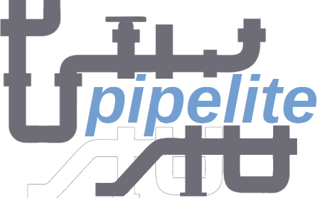

<p align="center">
  
</p>

<h1 align="center">pipelite</h1>

<p align="center">
  <strong>A lightweight, extensible Python framework for building data pipelines through simple JSON configuration</strong>
</p>

<p align="center">
  <a href="https://www.python.org/downloads/"></a>
  <a href="https://opensource.org/licenses/MIT"></a>
  <a href="https://pypi.org/project/pipelite/"></a>
  <a href="https://github.com/datacorner/pipelite/issues"></a>
</p>

---

## Table of Contents

- [Overview](#overview)
- [Key Features](#key-features)
- [Architecture](#architecture)
- [Installation](#installation)
- [Quick Start](#quick-start)
- [Configuration](#configuration)
- [Data Sources](#data-sources)
- [Transformers](#transformers)
- [Extending pipelite](#extending-pipelite)
- [Testing](#testing)
- [External Dependencies](#external-dependencies)
- [Contributing](#contributing)
- [License](#license)
- [Support](#support)

---

## Overview

**pipelite** empowers your data workflows effortlessly with a lightweight Python framework designed for seamless **data pipeline creation and execution**. Using simple JSON configuration files, users can build complex ETL (Extract, Transform, Load) pipelines without writing code.

What sets pipelite apart is its **total extensibility**—anyone can easily create and integrate new connectors or transformations, enhancing the framework's capabilities. With a MIT license fostering collaboration, this flexible tool is perfect for users of all levels.

```
┌─────────────┐     ┌─────────────┐     ┌─────────────┐
│  Extractors │────▶│ Transformers│────▶│   Loaders   │
│  (Sources)  │     │  (Process)  │     │  (Targets)  │
└─────────────┘     └─────────────┘     └─────────────┘
       │                   │                   │
       └───────────────────┴───────────────────┘
                           │
                    JSON Configuration
```

---

## Key Features

| Feature | Description |
|---------|-------------|
| **Code-Free Pipelines** | Build complex data pipelines using only JSON configuration |
| **Lightweight** | Minimal dependencies, leveraging standard Python libraries |
| **Extensible** | Easy to add custom data sources, transformers, and pipeline types |
| **Multiple Data Sources** | Support for CSV, Excel, Parquet, ODBC, SAP RFC, and more |
| **Rich Transformations** | Built-in transformers for joins, lookups, profiling, and data manipulation |
| **Sequential Processing** | Intelligent execution order based on data dependencies |
| **Data Profiling** | Built-in dataset profiling with HTML report generation |
| **Validation** | JSON Schema validation for configuration files |
| **Logging** | Comprehensive logging with configurable levels and rotation |

---

## Architecture

pipelite follows a modular ETL architecture:

```
pipelite/
├── baseobjs/           # Base classes for extensibility
│   ├── BODataSource    # Base class for data sources (extractors/loaders)
│   ├── BOTransformer   # Base class for transformers
│   └── BOPipeline      # Base class for pipeline orchestration
├── datasources/        # Built-in data source implementations
├── transformers/       # Built-in transformer implementations
├── pipelines/          # Pipeline execution strategies
└── config/             # Configuration management
```

### Core Concepts

- **Extractors**: Read data from various sources into datasets
- **Transformers**: Process and transform datasets (join, concat, filter, etc.)
- **Loaders**: Write transformed data to target destinations
- **Pipeline**: Orchestrates the execution flow between components

---

## Installation

### From PyPI (Recommended)

```bash
pip install pipelite
```

### From Source

```bash
git clone https://github.com/datacorner/pipelite.git
cd pipelite
pip install -e .
```

### Optional Dependencies

Some data sources require additional packages:

```bash
# For ODBC database connections
pip install pyodbc

# For SAP RFC connections
pip install pyrfc

# For Parquet file support
pip install pyarrow
```

---

## Quick Start

### 1. Create a Pipeline Configuration

Create a file named `my_pipeline.json`:

```json
{
    "classname": "pipelite.pipelines.sequentialPL",
    "extractors": [{
        "id": "source_data",
        "classname": "pipelite.datasources.csvFileDS",
        "parameters": {
            "separator": ",",
            "filename": "input.csv",
            "path": "./data/",
            "encoding": "utf-8"
        }
    }],
    "loaders": [{
        "id": "output_data",
        "classname": "pipelite.datasources.csvFileDS",
        "parameters": {
            "separator": ",",
            "filename": "output.csv",
            "path": "./data/out/",
            "encoding": "utf-8"
        }
    }],
    "transformers": [{
        "id": "transform",
        "classname": "pipelite.transformers.passthroughTR",
        "inputs": ["source_data"],
        "outputs": ["output_data"]
    }],
    "config": {
        "logger": {
            "level": "INFO",
            "path": "./logs/",
            "filename": "pipeline.log"
        }
    }
}
```

### 2. Run the Pipeline

```bash
pipelite -cfg my_pipeline.json
```

### 3. Using pipelite Programmatically

```python
from pipelite import pipelineProcess
from pipelite.config.cmdLineConfig import cmdLineConfig

# Load configuration
config = cmdLineConfig.set_config(cfg="my_pipeline.json")

# Get logger
log = pipelineProcess.getLogger(config)

# Execute pipeline
result = pipelineProcess(config, log).process()

# Check results
print(f"Errors: {log.errorCounts}")
print(f"Warnings: {log.warningCounts}")
```

---

## Configuration

### Pipeline Configuration Structure

```json
{
    "classname": "pipelite.pipelines.sequentialPL",
    "extractors": [...],
    "loaders": [...],
    "transformers": [...],
    "parameters": {...},
    "config": {
        "logger": {
            "level": "DEBUG|INFO|WARNING|ERROR",
            "format": "%(asctime)s|%(name)s|%(levelname)s|%(message)s",
            "path": "./logs/",
            "filename": "pipelite.log",
            "maxbytes": 1000000
        }
    }
}
```

### Object Configuration

Each extractor, loader, and transformer follows this structure:

```json
{
    "id": "unique_identifier",
    "classname": "full.module.path.ClassName",
    "parameters": {
        "param1": "value1",
        "param2": "value2"
    },
    "validation": "optional/path/to/schema.json"
}
```

### Transformer Configuration

Transformers additionally specify inputs and outputs:

```json
{
    "id": "my_transformer",
    "classname": "pipelite.transformers.concatTR",
    "inputs": ["dataset1", "dataset2"],
    "outputs": ["merged_dataset"],
    "parameters": {}
}
```

---

## Data Sources

### Supported Extractors & Loaders

| Data Source | Read | Write | Description |
|-------------|:----:|:-----:|-------------|
| [CSV File](https://github.com/datacorner/pipelite/wiki/csvFileDS) | ✅ | ✅ | Comma-separated values files |
| [Excel](https://github.com/datacorner/pipelite/wiki/excelFileDS) | ✅ | ❌ | Excel spreadsheets (xls, xlsx, xlsm, xlsb, odf, ods, odt) |
| [Parquet](https://github.com/datacorner/pipelite/wiki/parquetFileDS) | ✅ | ✅ | Apache Parquet columnar format |
| [XES File](https://github.com/datacorner/pipelite/wiki/xesFileDS) | ✅ | ❌ | Process mining event logs |
| [ODBC](https://github.com/datacorner/pipelite/wiki/odbcDS) | ✅ | ❌ | Any ODBC-compatible database |
| [SAP RFC](https://github.com/datacorner/pipelite/wiki/sapDS) | ✅ | ❌ | SAP tables via RFC |
| [ABBYY Timeline](https://github.com/datacorner/pipelite/wiki/piDS) | ❌ | ✅ | Process Intelligence repository |

### CSV Data Source Example

```json
{
    "id": "my_csv",
    "classname": "pipelite.datasources.csvFileDS",
    "parameters": {
        "separator": ",",
        "filename": "data.csv",
        "path": "/path/to/",
        "encoding": "utf-8"
    }
}
```

### ODBC Data Source Example

```json
{
    "id": "my_database",
    "classname": "pipelite.datasources.odbcDS",
    "parameters": {
        "connection_string": "Driver={SQL Server};Server=myserver;Database=mydb;",
        "query": "SELECT * FROM customers WHERE active = 1"
    }
}
```

---

## Transformers

### Available Transformers

| Transformer | Description |
|-------------|-------------|
| [Pass Through](https://github.com/datacorner/pipelite/wiki/passthroughTR) | Rename datasets without modification |
| [Concat](https://github.com/datacorner/pipelite/wiki/concatTR) | Concatenate multiple datasets vertically |
| [Join](https://github.com/datacorner/pipelite/wiki/joinTR) | Join datasets on common columns |
| [Lookup](https://github.com/datacorner/pipelite/wiki/lookupTR) | Enrich data with lookup tables |
| [Extract String](https://github.com/datacorner/pipelite/wiki/extractstrTR) | Extract substrings from columns |
| [Rename Column](https://github.com/datacorner/pipelite/wiki/renamecolTR) | Rename dataset columns |
| [Jinja Transform](https://github.com/datacorner/pipelite/wiki/jinjaTR) | Transform columns using Jinja2 templates |
| [Profile](https://github.com/datacorner/pipelite/wiki/profileTR) | Generate data profiling reports |

### Concat Transformer Example

```json
{
    "id": "merge_data",
    "classname": "pipelite.transformers.concatTR",
    "inputs": ["dataset_a", "dataset_b"],
    "outputs": ["merged_dataset"]
}
```

### Join Transformer Example

```json
{
    "id": "join_data",
    "classname": "pipelite.transformers.joinTR",
    "inputs": ["orders", "customers"],
    "outputs": ["enriched_orders"],
    "parameters": {
        "on": "customer_id",
        "how": "left"
    }
}
```

---

## Extending pipelite

### Creating a Custom Data Source

```python
from pipelite.baseobjs.BODataSource import BODataSource
from pipelite.plDataset import plDataset

class myCustomDS(BODataSource):
    
    def initialize(self, cfg) -> bool:
        """Initialize the data source with configuration."""
        self.my_param = cfg.getParameter("my_param", "default")
        return True
    
    def read(self) -> plDataset:
        """Read data and return a plDataset."""
        dataset = plDataset(self.config, self.log)
        # Load your data into dataset
        # dataset.set(your_dataframe)
        return dataset
    
    def write(self, dataset) -> bool:
        """Write a plDataset to the target."""
        # dataset.get() returns the pandas DataFrame
        df = dataset.get()
        # Write your data
        return True
```

### Creating a Custom Transformer

```python
from pipelite.baseobjs.BOTransformer import BOTransformer
from pipelite.plDatasets import plDatasets
from pipelite.plDataset import plDataset

class myCustomTR(BOTransformer):
    
    def initialize(self, params) -> bool:
        """Initialize transformer with parameters."""
        return True
    
    def process(self, dsTransformerInputs) -> plDatasets:
        """Process input datasets and return output datasets."""
        output = plDataset(self.config, self.log)
        
        # Process your data
        for input_ds in dsTransformerInputs:
            df = input_ds.get()
            # Transform the data
        
        # Set output ID and return
        output.id = self.dsOutputs[0]
        
        dsOutputs = plDatasets()
        dsOutputs.add(output)
        return dsOutputs
```

### Registering Custom Components

Use the full module path in your configuration:

```json
{
    "classname": "mypackage.mydatasources.myCustomDS"
}
```

---

## Testing

### Running Tests

```bash
# Install test dependencies
pip install pytest

# Run all tests
python -m pytest tests/ -v

# Run specific test file
python -m unittest tests.test_DS -v

# Run specific test
python -m unittest tests.test_TR.testTransformers.test_csv2csv_concat -v
```

### Test Coverage

The test suite covers:
- Data source operations (CSV, Excel, XES, Parquet)
- Transformer operations (concat, join, lookup, etc.)
- Pipeline execution and flow management
- Configuration validation

---

## External Dependencies

pipelite uses the following external libraries:

| Package | License | Purpose |
|---------|---------|---------|
| [pandas](https://pypi.org/project/pandas/) | BSD 3-Clause | Data manipulation and analysis |
| [openpyxl](https://pypi.org/project/openpyxl/) | MIT | Excel file support |
| [pyarrow](https://pypi.org/project/pyarrow/) | Apache 2.0 | Parquet file support |
| [Jinja2](https://pypi.org/project/Jinja2/) | BSD 3-Clause | Template-based transformations |
| [jsonschema](https://pypi.org/project/jsonschema/) | MIT | Configuration validation |
| [jsonpath-ng](https://pypi.org/project/jsonpath-ng/) | Apache 2.0 | JSON path queries |
| [xmltodict](https://pypi.org/project/xmltodict/) | MIT | XML parsing (XES files) |
| [requests](https://pypi.org/project/requests/) | Apache 2.0 | HTTP client (ABBYY Timeline) |
| [pyodbc](https://pypi.org/project/pyodbc/) | MIT | ODBC database connectivity |
| [pyrfc](https://pypi.org/project/pyrfc/) | Apache 2.0 | SAP RFC connectivity |

---

## Contributing

We welcome contributions! Please see our [Contributing Guide](CONTRIBUTING.md) for details.

### Development Setup

```bash
# Clone the repository
git clone https://github.com/datacorner/pipelite.git
cd pipelite

# Create virtual environment
python -m venv .venv
source .venv/bin/activate  # On Windows: .venv\Scripts\activate

# Install in development mode
pip install -e .

# Install dev dependencies
pip install pytest

# Run tests
python -m pytest tests/ -v
```

### Code Style

- Follow PEP 8 guidelines
- Add type hints to function signatures
- Include docstrings for public methods
- Write tests for new features

---

## License

This project is licensed under the MIT License - see the [LICENSE](LICENSE) file for details.

```
MIT License

Copyright (c) datacorner.fr

Permission is hereby granted, free of charge, to any person obtaining a copy
of this software and associated documentation files (the "Software"), to deal
in the Software without restriction, including without limitation the rights
to use, copy, modify, merge, publish, distribute, sublicense, and/or sell
copies of the Software, and to permit persons to whom the Software is
furnished to do so, subject to the following conditions:

The above copyright notice and this permission notice shall be included in all
copies or substantial portions of the Software.
```

---

## Support

- **Documentation**: [Wiki](https://github.com/datacorner/pipelite/wiki)
- **Issues**: [GitHub Issues](https://github.com/datacorner/pipelite/issues)
- **Discussions**: [GitHub Discussions](https://github.com/datacorner/pipelite/discussions)

---

## Acknowledgments

- Thanks to all contributors who have helped improve pipelite
- Built with ❤️ by [datacorner.fr](https://datacorner.fr)

---

<p align="center">
  <sub>If you find pipelite useful, please consider giving it a ⭐ on GitHub!</sub>
</p>
